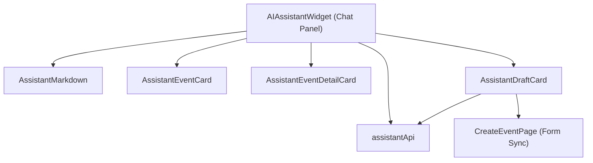
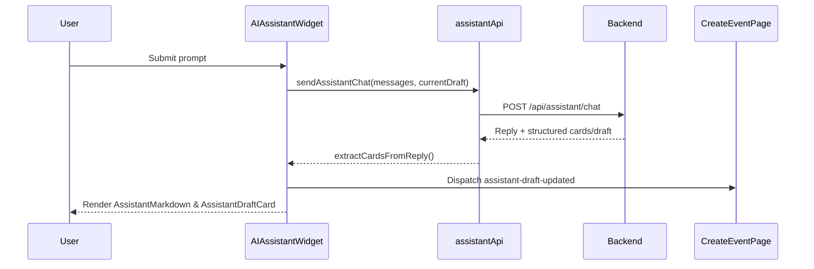

# Technical Design: AI Event Assistant & Tool Integration

<!-- toc -->

- [1. Architecture Overview](#1-architecture-overview)
  - [1.1 Architectural Vision](#11-architectural-vision)
  - [1.2 Architecture Drivers](#12-architecture-drivers)
  - [1.3 Architecture Layers](#13-architecture-layers)
- [2. Principles & Constraints](#2-principles--constraints)
  - [2.1 Design Principles](#21-design-principles)
  - [2.2 Constraints](#22-constraints)
- [3. Technical Architecture](#3-technical-architecture)
  - [3.1 Domain Model](#31-domain-model)
  - [3.2 Component Model](#32-component-model)
  - [3.3 API Contracts](#33-api-contracts)
  - [3.4 Internal Dependencies](#34-internal-dependencies)
  - [3.5 External Dependencies](#35-external-dependencies)
  - [3.6 Interactions & Sequences](#36-interactions--sequences)
  - [3.7 Database schemas & tables](#37-database-schemas--tables)
- [4. Additional context](#4-additional-context)
- [5. Traceability](#5-traceability)

<!-- /toc -->

- [x] `p1` - **ID**: `cpt-eventfrontend-design-ai-assistant`
## 1. Architecture Overview

### 1.1 Architectural Vision

The E-VENT Frontend AI Assistant module provides an interactive floating chat widget and rich card rendering system that connects signed-in attendees and event organizers with the backend AI Assistant orchestrator. It supports multi-turn natural language conversations, interactive event search result cards, single-event spotlight detail cards, and AI-generated draft event preview cards that can be published in one click or synchronized directly into the Create Event form.

The architecture cleanly separates presentation and interaction state (`src/components/assistant/`), form synchronization (`src/pages/CreateEventPage.tsx`), and HTTP transport / structured payload extraction (`src/lib/assistantApi.ts`).

### 1.2 Architecture Drivers

Key requirements that influence the frontend AI Assistant architecture decisions.

#### Functional Drivers

| Requirement | Design Response |
|-------------|-----------------|
| Conversational AI Assistant Chat | Floating chat dock (`AIAssistantWidget`) with per-account session isolation, conversation history loading, and markdown rendering (`AssistantMarkdown`). |
| Interactive Event Discovery Cards | Structured card extraction (`extractCardsFromReply`) and interactive event cards (`AssistantEventCard`, `AssistantEventDetailCard`). |
| AI Event Drafting & Creator Sync | Interactive draft preview card (`AssistantDraftCard`) with one-click publishing (`publishDraftEvent`) and live form synchronization into `CreateEventPage`. |

#### NFR Allocation

| NFR Area | NFR Summary | Allocated To | Design Response | Verification Approach |
|----------|-------------|--------------|-----------------|-----------------------|
| XSS Safety | Safe markdown rendering without raw HTML injection | `AssistantMarkdown` | Custom token parser avoiding `dangerouslySetInnerHTML` and filtering unsafe URL schemes | Unit tests in `AssistantMarkdown.test.tsx` |
| API Resilience | Graceful fallback when tool endpoints or network fail | `assistantApi` | Automatic fallback to REST `/api/events` endpoints and structured `AssistantApiError` retry banners | Unit tests in `assistantApi.test.ts` |

### 1.3 Architecture Layers

- [x] `p1` - **ID**: `cpt-eventfrontend-tech-react-typescript`

| Layer | Responsibility | Technology |
|-------|---------------|------------|
| Presentation | Floating chat panel, message thread, markdown & rich cards | React 18, TypeScript, Tailwind CSS, Framer Motion |
| Form Synchronization | Pre-filling and live-updating event creation fields from AI drafts | React Hooks, CustomEvent, SessionStorage |
| Service / API Client | REST communication with backend assistant and event endpoints | Fetch API, TypeScript typed contracts |

## 2. Principles & Constraints

### 2.1 Design Principles

#### Per-Account Conversation Isolation

- [x] `p1` - **ID**: `cpt-eventfrontend-principle-account-isolation`

Conversation state, cached session storage keys, and active draft payloads are strictly scoped to the authenticated user ID and cleared on sign-out or account switch.

#### Structured Card Progressive Enhancement

- [x] `p1` - **ID**: `cpt-eventfrontend-principle-structured-cards`

Assistant replies always render readable markdown text while progressively enhancing structured JSON payloads (`events`, `event_detail`, `draft`) into rich interactive UI cards.

### 2.2 Constraints

#### Authenticated Non-Admin Scope

- [x] `p1` - **ID**: `cpt-eventfrontend-constraint-auth-scope`

The AI Assistant widget must only render for authenticated non-administrator users on non-public application routes.

## 3. Technical Architecture

### 3.1 Domain Model

**Technology**: TypeScript interfaces

**Location**: [assistantApi.ts](../src/lib/assistantApi.ts)

**Core Entities**:

| Entity | Description | Schema |
|--------|-------------|--------|
| `ChatThreadMessage` | UI message model with text, role, status, and attached card payloads | [AIAssistantWidget.tsx](../src/components/assistant/AIAssistantWidget.tsx) |
| `AssistantEventItem` | Event summary or detail record returned by search and detail tools | [assistantApi.ts](../src/lib/assistantApi.ts) |
| `AssistantDraftEvent` | Draft event specification generated by the AI assistant | [assistantApi.ts](../src/lib/assistantApi.ts) |

**Relationships**:
- `ChatThreadMessage` → `AssistantEventItem`: One message may contain multiple search result events or one spotlight event detail.
- `ChatThreadMessage` → `AssistantDraftEvent`: One message may attach a structured event draft and validation issues list.

### 3.2 Component Model

#### Chat Panel & Message Thread (`AIAssistantWidget`)

- [x] `p1` - **ID**: `cpt-eventfrontend-component-chat-panel`

##### Why this component exists

Provides the persistent floating action button, minimized status pill, and slide-out chat drawer where users converse with the E-VENT AI Assistant.

##### Responsibility scope

- Manages drawer open/minimized state, account-scoped message history, prompt submission, retry handling, and real-time draft event broadcasting.

##### Responsibility boundaries

- Delegates markdown formatting to `AssistantMarkdown`, card rendering to card subcomponents, and network requests to `assistantApi`.

##### Related components (by ID)

- `cpt-eventfrontend-component-markdown-renderer` — renders assistant message prose
- `cpt-eventfrontend-component-event-search-card` — renders event search list items
- `cpt-eventfrontend-component-event-detail-card` — renders single event spotlight cards
- `cpt-eventfrontend-component-draft-card` — renders draft event preview cards
- `cpt-eventfrontend-component-assistant-api` — executes chat and history API requests

#### Markdown Renderer (`AssistantMarkdown`)

- [x] `p1` - **ID**: `cpt-eventfrontend-component-markdown-renderer`

##### Why this component exists

Renders assistant markdown responses (headings, lists, blockquotes, fenced code blocks, and inline links/emphasis) safely without XSS vulnerabilities.

##### Responsibility scope

- Tokenizes block and inline markdown syntax into React elements and provides one-click code block copy controls.

##### Responsibility boundaries

- Does not parse or strip structured JSON card payloads (handled upstream by `extractCardsFromReply`).

##### Related components (by ID)

- `cpt-eventfrontend-component-chat-panel` — embeds `AssistantMarkdown` for assistant replies

#### Event Search Result Card (`AssistantEventCard`)

- [x] `p1` - **ID**: `cpt-eventfrontend-component-event-search-card`

##### Why this component exists

Displays a compact, clickable summary card for each event returned by an assistant search query.

##### Responsibility scope

- Formats event category, cost badge, date/time range, venue name, capacity, and navigates to `/events/:id`.

##### Responsibility boundaries

- Does not fetch event data directly; receives `AssistantEventItem` props from the message thread.

##### Related components (by ID)

- `cpt-eventfrontend-component-chat-panel` — renders a list of `AssistantEventCard` items

#### Event Spotlight Detail Card (`AssistantEventDetailCard`)

- [x] `p1` - **ID**: `cpt-eventfrontend-component-event-detail-card`

##### Why this component exists

Displays an expanded spotlight card when the user asks for details about a specific event.

##### Responsibility scope

- Shows full event description, organizer identity and avatar, metadata grid, and a primary navigation CTA to the event page.

##### Responsibility boundaries

- Pure presentational component driven by `AssistantEventItem`.

##### Related components (by ID)

- `cpt-eventfrontend-component-chat-panel` — renders `AssistantEventDetailCard` for single-event responses

#### Event Draft Preview Card (`AssistantDraftCard`)

- [x] `p1` - **ID**: `cpt-eventfrontend-component-draft-card`

##### Why this component exists

Allows users to review AI-drafted events, inspect validation warnings, copy a summary, publish directly from chat, or open the draft inside the Create Event editor.

##### Responsibility scope

- Renders draft metadata, validation issues, direct publish action (`publishDraftEvent`), and navigation/prefill trigger for `CreateEventPage`.

##### Responsibility boundaries

- Delegates actual HTTP creation to `assistantApi` and full manual editing to `CreateEventPage`.

##### Related components (by ID)

- `cpt-eventfrontend-component-assistant-api` — calls `publishDraftEvent`
- `cpt-eventfrontend-component-create-event-sync` — receives prefilled draft via router state, session storage, or custom DOM event

#### Assistant API Client (`assistantApi`)

- [x] `p1` - **ID**: `cpt-eventfrontend-component-assistant-api`

##### Why this component exists

Encapsulates all HTTP interactions with the backend AI Assistant endpoints, structured card extraction, error normalization, and fallback queries.

##### Responsibility scope

- Implements `sendAssistantChat`, `fetchAssistantHistory`, `startAssistantConversation`, `searchAssistantEvents`, `getAssistantEventDetails`, `draftAssistantEvent`, `publishDraftEvent`, and `extractCardsFromReply`.

##### Responsibility boundaries

- Stateless service layer; does not hold React component state.

##### Related components (by ID)

- `cpt-eventfrontend-component-chat-panel` — primary consumer for chat and history
- `cpt-eventfrontend-component-draft-card` — consumer for one-click draft publishing

#### Create Event Form Draft Synchronization (`CreateEventPage`)

- [x] `p1` - **ID**: `cpt-eventfrontend-component-create-event-sync`

##### Why this component exists

Synchronizes AI-generated event drafts into the manual event creation form so organizers can refine and publish events seamlessly.

##### Responsibility scope

- Applies draft title, description, category, date/time range, venue, coordinates, cost, and capacity from router state, `sessionStorage`, or live `assistant-draft-updated` events.

##### Responsibility boundaries

- Owns the Create Event form lifecycle and final multi-occurrence event submission.

##### Related components (by ID)

- `cpt-eventfrontend-component-draft-card` — dispatches draft prefill state and navigation
- `cpt-eventfrontend-component-chat-panel` — dispatches `assistant-draft-updated` custom events

### 3.3 API Contracts

- [x] `p1` - **ID**: `cpt-eventfrontend-interface-assistant-rest`

- **Technology**: REST / JSON over HTTPS with Bearer JWT authentication
- **Location**: [assistantApi.ts](../src/lib/assistantApi.ts)

**Endpoints Overview**:

| Method | Path | Description | Stability |
|--------|------|-------------|-----------|
| `POST` | `/api/assistant/chat` | Send conversation history and active draft to AI orchestrator | stable |
| `GET` | `/api/assistant/messages` | Fetch active conversation message history for signed-in user | stable |
| `POST` | `/api/assistant/conversations` | Start a new server-side assistant conversation | stable |
| `POST` | `/api/assistant/tools/search-events` | Execute structured event search tool with `/api/events/` fallback | stable |
| `POST` | `/api/assistant/tools/event-details` | Fetch single event details with `/api/events/:id` fallback | stable |
| `POST` | `/api/assistant/tools/draft-event` | Generate structured event draft from natural language prompt | stable |

### 3.4 Internal Dependencies

| Dependency Module | Interface Used | Purpose |
|-------------------|----------------|---------|
| `@/lib/auth` | `getAuthToken`, `notifyAuthExpired`, `AUTH_TOKEN_EVENT` | Attach Bearer JWT and handle session expiration |
| `@/lib/storage` | `getCurrentUser`, `addEvent` | Scope chat history per user and persist published draft events locally |
| `@/lib/queries` | `invalidateEvents`, `prependCreatedEvent` | Refresh React Query event caches after draft publication |

### 3.5 External Dependencies

#### Backend AI Orchestrator & Event REST API

| Dependency Module | Interface Used | Purpose |
|-------------------|---------------|---------|
| FastAPI Backend (`/api/assistant/*`, `/api/v1/events/`) | JSON REST API | LLM orchestration, tool execution, and event persistence |

### 3.6 Interactions & Sequences

#### Multi-Turn Chat & Draft Synchronization Sequence

**ID**: `cpt-eventfrontend-seq-assistant-chat-draft`

**Description**: User sends a prompt in the chat drawer; `assistantApi` posts the turn history and latest draft context to the backend, extracts structured event/draft cards, updates any open `CreateEventPage` form, and renders interactive cards in the message thread.

### 3.7 Database schemas & tables

- [x] `p2` - **ID**: `cpt-eventfrontend-db-session-storage`

#### Table: session_storage_assistant_keys

**ID**: `cpt-eventfrontend-dbtable-session-storage`

**Schema**:

| Column | Type | Description |
|--------|------|-------------|
| `event_assistant_chat_history_v1:{userId}` | JSON array | Per-account cached `ChatThreadMessage[]` thread |
| `event_assistant_draft_prefill` | JSON object | Pending `AssistantDraftEvent` payload for `CreateEventPage` |

**PK**: Storage key string

**Constraints**: Scoped to browser `window.sessionStorage`; cleared on sign-out or account change.

## 4. Additional context

All AI assistant frontend components and service functions maintain 100% CDSL specification coverage via Constructor Fabric Studio traceability markers.

## 5. Traceability

- **Features**: [architecture/features/ai-assistant.md](../architecture/features/ai-assistant.md)
